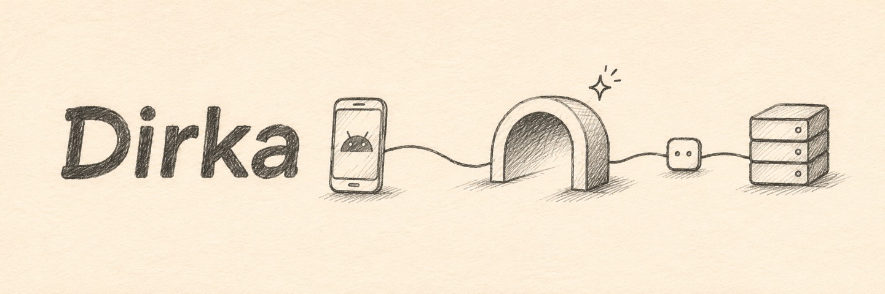

# 

Dirka is an Android client for [node-tunnel](https://github.com/mgrybyk/node-tunnel).
It lets Android apps reach the TCP service a node-tunnel agent is configured to
forward to. Apps connect to a local port opened by Dirka, which sends their
traffic through the relay to the agent.

**[Download the APK on GitHub Releases →](https://github.com/mgrybyk/dirka-mobile/releases)**

## Install

On an **ARM64 device running Android 13 or later**, download the
`dirka-*-android-arm64.apk` and open it to install. If Android prompts you,
allow the app you opened the APK with to install unknown apps.

If a release APK is unavailable, follow the [build instructions](docs/development.md#toolchain).

## Use

1. Open Dirka, tap **Add client**, paste your node-tunnel `client.env`, and tap **Save**.
2. Tap **Connect** and wait for **Connected to agent**.
3. In the Android app that will use the tunnel, connect to your configured bind
   address and local port. For a loopback bind, use `127.0.0.1` or `::1` as configured.
4. Tap **Disconnect** in Dirka when you're done.

See [configuration and compatibility](docs/configuration.md) and
[development documentation](docs/development.md).
